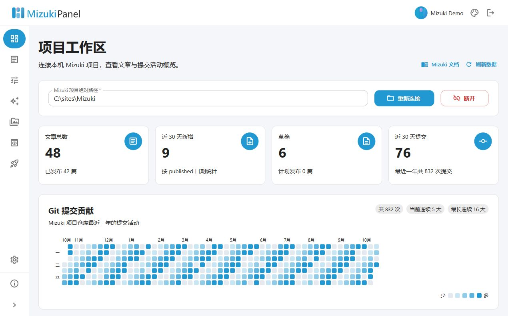
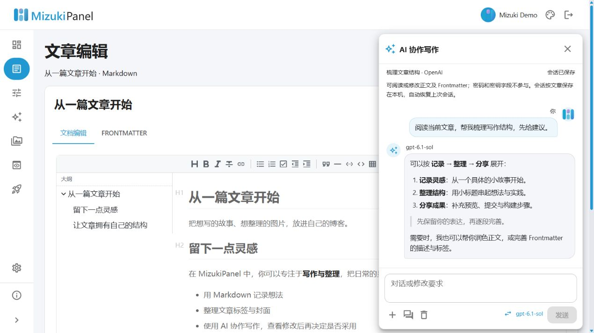
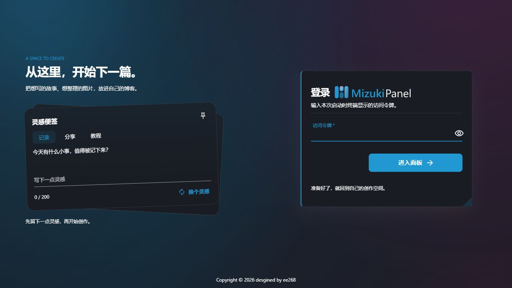
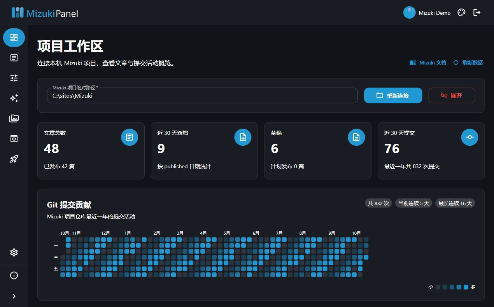

<p align="center">
  <picture>
    <source media="(prefers-color-scheme: dark)" srcset="static/mizuki-panel-logo-dark.svg">
    
  </picture>
</p>
<p align="center">为 Mizuki 博客准备的本地创作与管理工作台。</p>
<p align="center">写文章、整理图片、调整站点，直到预览、提交与构建。</p>

<p align="center">
  
  
  
  
</p>

<p align="center">
  <a href="#简介">简介</a> ·
  <a href="#功能亮点">功能亮点</a> ·
  <a href="#快速开始">快速开始</a> ·
  <a href="#界面预览">界面预览</a> ·
  <a href="#数据与安全">数据与安全</a> ·
  <a href="#文档导航">文档导航</a>
</p>

## 简介

MizukiPanel 是面向 Mizuki 博客的本地管理面板，将文章编辑、站点配置、媒体管理、站点预览与 Git 操作整合到一个工作台。它直接连接本机 Mizuki 项目，文章和资源保存在项目目录中，面板设置、备份与会话保存在本机。

项目使用 **GPT-6.1 Sol** 进行开发，并围绕实际创作与管理需求持续迭代。

## 功能亮点

| 功能 | 你可以做什么 |
| --- | --- |
| **项目工作区** | 连接与切换最近项目，查看文章统计、热门标签、近期文章和 Git 提交贡献，快速打开 Mizuki 文档。 |
| **文章编辑** | 使用 Vditor 编辑 Markdown，独立管理 Frontmatter；支持大纲、图片、代码、表格、新文章模板、草稿恢复和可配置的自动保存。 |
| **AI 协作写作** | 接入 OpenAI 兼容服务或 Anthropic，切换多个模型；让 AI 阅读、分析或修改正文与 Frontmatter，先比较差异，再决定是否采用。每篇文章支持多个可恢复、可改名的会话。 |
| **站点配置** | 搜索卡片快速定位 18 项配置；分区标签编辑、语法高亮，每项独立保留最近 5 份编辑前备份。 |
| **特色页面** | 管理友链、关于、日记、追番等页面，并调整页面开关；关于页使用 Markdown 编辑器，检测到季度追番文件时提供季度管理与 Bangumi 条目搜索。 |
| **媒体管理** | 扫描项目图片并按文件夹展示，排除构建与缓存目录；支持目录封面、按视口加载、上传、可选图片处理，以及缩放和上一张／下一张浏览。 |
| **Mizuki 预览与发布** | 启动本地站点预览；查看分支、远程仓库和最近 100 条 Git 提交，查询全部历史、查看差异、提交选定文件、推送并运行 Mizuki 构建，操作过程显示日志。 |
| **个性化与维护** | 切换深浅色、主题色和字体，调整编辑器、上传与日志偏好；管理备份、独立回收站及设置导入导出。 |

## 快速开始

### 1. 准备环境

- **Node.js ≥ 20.19**。
- **pnpm 10.28.2**，与仓库的 `packageManager` 声明一致。
- 一个已安装依赖的 **本地 Mizuki 项目**。面板与博客项目可以放在不同目录。
- **Git**：用于提交贡献、历史、差异、提交和推送功能。

AI API Key 的加密持久化目前支持 **Windows**；其他系统可临时填写密钥使用，不会降级为明文保存。

### 2. 下载并启动面板

```bash
git clone https://github.com/ee268/MizukiPanel.git
cd MizukiPanel
pnpm install
pnpm dev
```

### 3. 登录并连接 Mizuki

1. 打开终端显示的登录地址，默认是 **[http://127.0.0.1:4173/login](http://127.0.0.1:4173/login)**。
2. 输入终端显示的**本次启动访问令牌**。每次重启服务都会生成新令牌。
3. 在工作区填写 Mizuki 项目的**绝对路径**，例如 `C:\sites\Mizuki`，点击连接。
4. 从侧栏进入文章管理，打开文章开始编辑；进入 Mizuki 预览检查站点效果。

面板只监听本机 `127.0.0.1`。首次连接时会检查项目结构与读写能力；不可安全写入的项目显示为只读，并给出原因。

### 使用构建版本

```bash
pnpm build
pnpm start
```

`pnpm build` 构建的是 **MizukiPanel**。发布管理页的“构建 Mizuki”则在已连接的博客项目中运行 `pnpm run build`，两者是不同的构建目标。

<details>
<summary>修改面板端口（PowerShell 示例）</summary>

```powershell
$env:PANEL_PORT = "4180"
pnpm dev
```

打开终端输出的新地址。开发模式还会使用相邻端口运行 API；Mizuki 预览端口默认是 `4321`，可在设置页单独调整。

</details>

## 界面预览

预览展示当前组件与演示内容，不包含真实文章、访问令牌或 API Key。图片随仓库保存，克隆后也可查看。

### 项目工作区

<p align="center">
  <picture>
    <source media="(prefers-color-scheme: dark)" srcset="docs/assets/screenshots/workspace-dark.png">
    
  </picture>
</p>

<p align="center"><sub>工作区预览随 GitHub 的深浅色主题切换。</sub></p>

### 文章编辑

Markdown 即时渲染、大纲、独立 Frontmatter，以及可与编辑器同时使用的 AI 协作对话框。预览中的演示会话展示 Markdown 回复、模型切换与消息输入区。



<details>
<summary>查看登录页</summary>

渐变背景、灵感便签与书页签笺登录卡片；移动端隐藏创意小组件。



</details>

<details>
<summary>查看深色工作区</summary>



</details>

## 数据与安全

### 本机存储

默认状态目录是 **MizukiPanel 项目下的 `.local/`**，已被 Git 忽略。登录同一面板后，不同浏览器共享已保存的设置。

| 位置 | 保存内容 |
| --- | --- |
| `.local/personal-settings.json` | 外观、字体、编辑器、自动保存等界面与编辑偏好。 |
| `.local/settings.json`、`.local/project-settings/` | 本机策略及按项目隔离的设置。 |
| `.local/workspace-history.json` | 连接记录与最近项目。 |
| `.local/ai-conversations/` | 按项目、文章隔离的 AI 会话与修改建议。 |
| `.local/secure/ai-credentials.dpapi.json` | Windows DPAPI 加密的 AI 配置与密钥。 |
| `.local/config-backups/`、`.local/recycle-bin/` | 配置编辑快照，以及明确选择移入回收站的文件。 |

文章、配置和图片的保存会修改对应 Mizuki 项目文件。**`.local/` 不随 Git 提交备份**，迁移面板时需要单独保留；也可通过设置页预览、恢复备份或导入导出偏好。普通偏好导出不包含 API Key。

### AI 与文件操作

- 打开 AI 面板不会立即请求服务。需要阅读、分析或编辑文章时才发送当前草稿，包括尚未保存的正文与 Frontmatter；这些内容会传给你配置的 AI 服务。
- AI 修改先进入对比视图，点击采用后才更新文章草稿。文章自动保存默认关闭，可分别选择正文、Frontmatter 或两者，以及定时、离开时保存。
- API Key 不进入普通偏好、导出或会话文件。Windows 加密文件绑定当前账户；换账户或机器后需重新配置密钥。
- 面板执行 Git 提交、推送前检查敏感内容；这些检查不能拦截外部终端操作，提交前仍应核对暂存文件。
- 删除文章时可选择回收站或永久删除；关联 AI 会话一起处理。回收站只统计专用目录中的回收项，恢复文章时同时恢复其会话。

具体行为与限制见 [AI 辅助写作](docs/AI_WRITING.md)和 [设置使用说明](docs/PANEL_SETTINGS_USAGE.md)。

## 文档导航

| 文档 | 内容 |
| --- | --- |
| [设置使用说明](docs/PANEL_SETTINGS_USAGE.md) | 保存范围、自动保存、模板、图片处理、备份与回收站。 |
| [Vditor 编辑器](docs/VDITOR_EDITOR.md) | 编辑模式、Markdown 渲染与兼容边界。 |
| [AI 辅助写作](docs/AI_WRITING.md) | 服务配置、模型、会话、正文／Frontmatter 修改及密钥保护。 |
| [发布管理](docs/PUBLISHING.md) | Git 历史、差异、提交、推送、构建与运行日志。 |
| [工作区与安全同步](docs/STAGE_2.md) | 项目检测、独立内容模式、同步协议及只读处理。 |
| [项目架构](docs/ARCHITECTURE.md) | 客户端、服务端、共享契约与模块边界。 |
| [结构重构说明](docs/STRUCTURE_REFACTOR.md) | 公共能力提取与模块职责划分。 |

## 开发与贡献

界面使用 **React + Material UI**，客户端由 **Vite** 构建；服务端使用 **Hono**，文章编辑基于 **Vditor**，结构化配置编辑使用 **CodeMirror**。

```text
src/
├── client/    # 页面、组件、设置与编辑交互
├── server/    # API 路由与服务启动
├── lib/       # 文件、工作区、Git、备份与 AI 等业务能力
└── shared/    # 客户端与服务端共享的类型、规则与契约
scripts/       # 本机启动与开发辅助
static/        # Logo、图标与静态资源
tests/         # 自动化测试
docs/          # 使用说明、架构与界面预览
```

提交代码前运行：

```bash
pnpm check
pnpm format:check
pnpm test
pnpm build
```

欢迎通过 [Issues](https://github.com/ee268/MizukiPanel/issues)反馈问题，或提交 [Pull Request](https://github.com/ee268/MizukiPanel/pulls)。问题报告请附复现步骤、运行环境与经过脱敏的日志；提交内容中不要包含 `.local/`、访问令牌、API Key 或私人文章。

感谢 [Mizuki](https://github.com/matsuzaka-yuki/Mizuki)，以及 [Vditor](https://github.com/Vanessa219/vditor)、[Material UI](https://github.com/mui/material-ui)、[CodeMirror](https://github.com/codemirror/dev)等开源项目。
