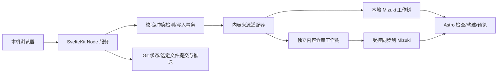

# MizukiPanel 首个 Release 设计文档

状态：设计稿，待确认后进入按阶段构建  
目标版本：`v1.0.0`（首个完整可用版本）  
设计日期：2026-09-26  
目标运行环境：用户本机，浏览器访问本机面板  
已确认范围：本地内容与独立内容仓库两种模式；全部特色页

## 1. 目标与边界

MizukiPanel 是一个独立于 Mizuki 静态站点运行的本机管理程序。它直接管理 Mizuki 的内容文件、配置文件和媒体文件，保留现有 Astro 站点作为最终渲染与构建者。面板不把文章迁入数据库，也不要求博客站点常驻服务器。用户可以在面板中编辑、校验、预览、保存，并明确执行 Git 提交、推送和构建。

首版包含：

- 文章的创建、列表、筛选、编辑、复制、重命名、删除、草稿切换和发布检查，覆盖 `.md` 与 `.mdx`。
- 文章 Frontmatter 中当前 schema 的可编辑字段；未知字段原样保留并提示。正文提供源码编辑，Markdown 辅助输入；MDX 始终保留源码编辑能力。
- 图片与附件上传、浏览、引用、重命名和删除，覆盖文章同目录资源、`public/images/` 与相册目录。
- 常用站点配置和其余可覆盖配置的分组编辑；复杂或非字面量配置提供源码视图和受控编辑，不静默重写。
- 关于、友链、日记、追番、相册、项目、技能、设备、时间线、AI 工具等特色页的内容管理，以及页面开关与导航入口的联动提示。
- 本地内容模式、独立内容仓库模式的项目识别、源目录选择、变更预览、校验、构建和 Git 工作流。
- 本机访问保护、文件安全、冲突检测、备份与恢复、操作日志和完整的用户文档。

首版不包含多用户协作、云端托管面板、第三方图床/对象存储接入、评论服务后台、访问统计后台、定时发布、自动向云平台部署、MDX 的完全所见即所得编辑。Mizuki 已有的 Bangumi、Bilibili、Memos 远端数据模式在面板中可配置和查看状态；面板不改写第三方服务中的数据。

## 2. 已核对的 Mizuki 事实

以源代码为准，文档与代码不一致时先按代码设计适配器，并在实施阶段用真实构建验证。

| 能力 | 当前来源 | 面板需要遵守的约束 |
| --- | --- | --- |
| 文章 | [`src/content.config.ts`](../../Mizuki/src/content.config.ts)、[`src/loaders/post-loader.ts`](../../Mizuki/src/loaders/post-loader.ts)、`src/content/posts/**/*.{md,mdx}` | `title`、`published` 必填；日期仅日期与带时区时间要区分；保留未知 Frontmatter 和正文。 |
| 文章 URL | [`src/utils/post-url.ts`](../../Mizuki/src/utils/post-url.ts)、[`src/utils/permalink-utils.ts`](../../Mizuki/src/utils/permalink-utils.ts) | `alias`、`permalink` 与全局模板影响 URL；保存前检查路径冲突，重命名时提示链接变化。 |
| 特殊 Markdown 页面 | `src/content/spec/about.md`、`friends.md` | 可直接编辑正文；友链列表另由 `src/data/friends.ts` 提供。 |
| 结构化特色页 | `src/data/friends.ts`、`diary.ts`、`anime.ts`、`projects.ts`、`skills.ts`、`timeline.ts`、`devices.ts`、`ai-tools.ts` | 文件是 TypeScript 模块，不应以正则或执行任意模块的方式重写；使用 AST 定位受支持的数据对象/数组。 |
| 追番季度页 | [`src/utils/bgm-anime.ts`](../../Mizuki/src/utils/bgm-anime.ts)、`src/content/animes/{年份}/{季度}月.md` | 季度页与 `src/data/anime.ts` 是两套不同内容入口，都纳入首版。 |
| 相册 | [`src/utils/album-scanner.ts`](../../Mizuki/src/utils/album-scanner.ts)、`public/images/albums/<id>/info.json` | 目录名是相册 ID；本地图片与外链图片模式都要支持。 |
| 站点配置 | [`src/config/index.ts`](../../Mizuki/src/config/index.ts)、[`src/types/config.ts`](../../Mizuki/src/types/config.ts) | 配置分布在多个 TS 模块；18 个配置支持 `overrides/` 深合并，但该机制在 Mizuki 文档中标记为实验性。 |
| 内容分离 | [`scripts/sync-content.js`](../../Mizuki/scripts/sync-content.js)、[`docs/CONTENT_SEPARATION.md`](../../Mizuki/docs/CONTENT_SEPARATION.md) | 独立仓库中的 `posts/`、`spec/`、`data/`、`images/`、`overrides/` 映射到运行目录；当前脚本会 stash、fetch、hard reset、替换目录并尝试 `git add .` 和提交。面板不能把同步后的副本当原始数据。 |
| 构建与预览 | [`package.json`](../../Mizuki/package.json)、[`astro.config.mjs`](../../Mizuki/astro.config.mjs) | Astro 负责最终渲染；面板预览与发布检查不能假定通用 Markdown 渲染等于 Mizuki 的 MDX/remark/rehype 效果。 |

核对过的说明包括 Mizuki 的 [README](../../Mizuki/README.md)、[文档索引](../../Mizuki/docs/README.md)、[内容编写](../../Mizuki/docs/CONTENT_AUTHORING.zh.md)、[内容渲染](../../Mizuki/docs/CONTENT_RENDERING.md)、[内容分离](../../Mizuki/docs/CONTENT_SEPARATION.md)、[内容仓库结构](../../Mizuki/docs/CONTENT_REPOSITORY.md)、[迁移](../../Mizuki/docs/MIGRATION_GUIDE.md)、[部署](../../Mizuki/docs/DEPLOYMENT.md)、[自动构建](../../Mizuki/docs/AUTO_BUILD_TRIGGER.md)、[性能监控](../../Mizuki/docs/PERFORMANCE_MONITORING.md)和 `docs/rule/` 下的组件、文件组织、样式、侧栏及图标规范。`docs/editor/` 是浏览器内的独立编辑器示例，主要使用 `localStorage` 和下载文件，不能直接作为可持久化后台。

有三处必须在第一阶段做兼容性检查：

1. `.env.example` 与说明倾向本地模式，但 `sync-content.js` 的实际判断是 `ENABLE_CONTENT_SYNC !== "false"`；变量缺失时会尝试同步。面板必须明确识别并展示最终模式。
2. README 称 `src/data/ai-tools.ts` 在内容同步时受到保护；当前脚本却把整个 `data/` 目录映射到 `src/data/`。实施时以真实脚本行为为准，修正同步契约并做回归测试。
3. `src/content/animes/` 未在当前独立仓库同步映射中，首版若要同时支持独立仓库与全部特色页，必须扩展内容仓库映射及迁移说明。

Mizuki README 已声明该主题将停止更新并迁移到 Shirone。本项目的兼容目标仍为当前工作区中的 Mizuki 版本；首版不承诺自动兼容 Shirone。

## 3. 技术栈

| 层 | 选择 | 原因 |
| --- | --- | --- |
| 本机 Web 应用 | SvelteKit 2、Svelte 5、TypeScript strict、`@sveltejs/adapter-node` | Mizuki 已使用 Svelte；SvelteKit 同时提供界面、服务端路由和表单动作，Node 适合访问本地文件与 Git。以 Node 20+ 为基线，与 Mizuki 要求一致。 |
| 包管理与构建 | pnpm、Vite | 与 Mizuki 的 pnpm 工作流接近；面板作为独立项目固定自己的依赖版本。 |
| UI 组件库 | Skeleton（`@skeletonlabs/skeleton`、`@skeletonlabs/skeleton-svelte`）+ Tailwind CSS 4 | 以成熟组件库统一表单、弹窗、选择器、导航、反馈和主题；Tailwind 只用于布局与少量业务定制，不自行实现通用交互组件。Skeleton 官方支持 SvelteKit 2、Svelte 5 和 Tailwind 4。 |
| 大型内容列表 | `@tanstack/svelte-table` + Skeleton 表格样式 | 文章和媒体列表需要排序、筛选、分页及选择；表格状态由 TanStack Table 管理，视觉保持 Skeleton 一致。 |
| 图标 | Iconify | 与 Mizuki 的图标体系接近，但面板图标独立安装，不依赖博客构建产物。 |
| 内容编辑 | CodeMirror 6；`yaml` 的 Document API | 适合源码编辑与语法高亮；YAML 修改尽量保留注释、顺序和未知字段。对不能安全往返的语法拒绝结构化写入，保留源码编辑。 |
| TS 配置/数据编辑 | TypeScript Compiler API 或 `ts-morph` 的 AST 操作 | 定位导出变量和字面量节点，最小化修改；遇到函数调用、展开、计算表达式时只读或转源码编辑并显示差异。绝不通过 `eval` 执行配置文件。 |
| 校验 | Zod + Mizuki 自身的 `astro check`、`type-check`、`build` | 面板先做快速输入校验，最终以博客项目的真实类型检查和构建为准。 |
| 自动化验证 | Vitest、Playwright | 单元测试覆盖解析、写入、路径和冲突；端到端测试覆盖主要编辑与发布流程。 |
| Git | 调用受控参数的 Git CLI（`execFile`，不拼接 shell 命令） | 只暂存面板选中的文件；让用户检查提交和推送，不执行 force push。 |
| 数据存储 | 内容仍为文件；面板只保存本机工作区设置与会话信息 | 不引入与 Mizuki 文件并行的内容数据库，避免双份真相。 |

采用官方支持的 [SvelteKit Node 适配器](https://svelte.dev/docs/kit/adapter-node) 和 [表单动作](https://svelte.dev/docs/kit/form-actions)。UI 组件选用 [Skeleton 的 SvelteKit 安装方案](https://www.skeleton.dev/docs/svelte/get-started/installation/sveltekit)；它也列在 [Svelte 生态组件库目录](https://svelte.dev/packages)中。文章编辑器和 Git 差异视图属于业务专用界面，继续使用 CodeMirror，不强塞进通用组件库。YAML 文档节点的修改能力见 [`yaml` 官方说明](https://eemeli.org/yaml/)，TS 对象字面量的 AST 操作见 [`ts-morph` 文档](https://ts-morph.com/details/object-literal-expressions)。具体依赖版本在正式开工时固定在锁文件，不在设计稿中猜测未来版本。

## 4. 总体架构与数据来源



项目首次连接时指定 Mizuki 根目录。面板读取 `package.json`、`src/content.config.ts`、`.env` 与 Git 状态，确认目录确实是可管理的 Mizuki 工作树。`CONTENT_DIR` 相对路径按 Mizuki 根目录解析。检测到链接、目录联接或复制镜像时，界面显示**原始写入目录**，绝不把镜像路径作为唯一保存位置。

### 4.1 两种模式的写入矩阵

| 内容 | 本地模式写入 | 独立仓库模式写入 |
| --- | --- | --- |
| 文章 | `Mizuki/src/content/posts/` | `<CONTENT_DIR>/posts/` |
| 关于/友链正文 | `Mizuki/src/content/spec/` | `<CONTENT_DIR>/spec/` |
| 结构化页面数据 | `Mizuki/src/data/` | `<CONTENT_DIR>/data/`；与外部 API 数据明确区分 |
| 相册与公共图片 | `Mizuki/public/images/` | `<CONTENT_DIR>/images/` |
| 追番季度 Markdown | `Mizuki/src/content/animes/` | `<CONTENT_DIR>/animes/`，需要同步契约扩展 |
| 站点配置 | `Mizuki/src/config/*.ts` 的受支持字段 | `<CONTENT_DIR>/overrides/<导出名>.ts`，由 Mizuki 合并进默认配置 |

本地模式中的站点配置直接修改现有 TS 源文件，保证正常 Git 提交与部署。独立仓库模式使用现有的 `overrides/` 机制，面板展示“默认值、覆盖值、最终值”，明确数组整体替换、`undefined` 跳过、不能表达删除的语义。对覆盖无法表示的配置操作给出不可操作提示和手动处理说明，不伪装成保存成功。切换模式需要显式迁移向导、备份和逐项对照，不在后台自动切换。

### 4.2 保存、预览与发布

1. **保存**：只写原始内容目录，校验目标文件版本；写入前生成 diff，原子替换并留下恢复点。不自动 Git 提交。
2. **预览**：本机启动或连接 Mizuki Astro 开发服务，使用 Mizuki 自己的渲染管线；面板的轻量预览只作为辅助，MDX 和增强语法以 Astro 页面为准。独立仓库模式先完成受控同步后才能预览。
3. **发布检查**：运行路径、Frontmatter、资源引用、配置类型、`pnpm check`、`pnpm type-check` 和 `pnpm build`。长任务展示日志和取消入口。
4. **提交/推送**：显示将提交的文件和目标仓库；本地模式提交 Mizuki 仓库，独立模式先提交/推送内容仓库，再按现有部署机制触发站点构建。任何推送、提交、构建都由用户在面板中明确发起；失败不自动重试破坏性 Git 操作。

当前 `sync-content.js` 会对已有独立仓库 stash 后 hard reset、替换目录、再对 Mizuki 执行 `git add .` 和提交。首版必须在 Mizuki 侧改造这一集成点：同步前检查未提交变更，默认拒绝覆盖；使用明确的 fetch 与安全更新策略；只同步约定的文件；取消全仓库自动暂存和提交；加入 `animes/`；针对 Windows 联接与复制回退分别验证。面板不得在未完成该改造前对独立仓库模式宣称“保存后可安全预览/构建”。

## 5. 功能设计

### 5.1 文章与编辑器

- 列表按标题、日期、草稿、分类、标签、文件路径搜索和筛选；文件相对路径是稳定的编辑标识，不依赖生成后的 URL。
- 表单按 [`CONTENT_AUTHORING.zh.md`](../../Mizuki/docs/CONTENT_AUTHORING.zh.md) 和实际 schema 管理标题、日期、摘要、封面、标签、分类、语言、置顶、排序、评论、作者、来源、许可、加密、别名及固定链接。
- 日期输入保留 `YYYY-MM-DD` 或带时区 ISO 时间戳的原始形式。避免格式化造成发布时间偏移。
- 正文编辑器支持 Markdown/MDX 源码、常用语法插入、图片引用、未保存变更提醒、快捷保存。MDX 组件导入和自定义语法不经简化渲染器往返。
- 新建时选择单文件或 `index.md(x)` 加资源目录；移动/重命名后检查相对图片和 Wiki Link；删除先移入可恢复区。
- 对加密文章只说明 Mizuki 的浏览器端加密边界；不在日志、预览 URL 或提交说明里输出密码。

### 5.2 配置

分组提供：站点基础与 SEO、主题色与横幅/壁纸、导航、个人资料、侧栏、评论、音乐、公告与页脚、分享与许可、链接/固定链接、Markdown/代码块、页面开关、特效及 Live2D。适配 `src/config/index.ts` 中列出的 18 个可覆盖配置名；本地模式还要考虑 `siteConfig.ts` 的 `SITE_LANG` 常量与关联评论语言。复杂字段允许受控源码编辑，并在写入前运行 AST/类型校验。所有配置展示差异、恢复点及“这次修改影响哪些页面”的提示。

不把 `.env` 中的 Bilibili 会话、Git 凭据、IndexNow 密钥等秘密值写入前端状态或日志。首版仅显示必要的“是否配置”状态；秘密值继续由本机或部署平台管理。

### 5.3 特色页与媒体

| 面板模块 | 管理源与首版操作 |
| --- | --- |
| 关于 | `spec/about.md` 正文编辑、预览。 |
| 友链 | `spec/friends.md` 正文；`data/friends.ts` 列表增删改、排序、标签和链接校验。 |
| 日记 | `data/diary.ts` 条目增删改、图片引用；Memos 模式只配置地址与状态。 |
| 追番 | `data/anime.ts` 本地列表；`content/animes/<年>/<季度>月.md` 季度内容与 Bangumi ID；Bangumi/Bilibili 模式只配置源并展示更新状态。 |
| 相册 | `images/albums/<id>/info.json`、本地照片、封面、外链照片、隐藏及现有加密字段。 |
| 项目、技能、设备、时间线、AI 工具 | 对应 `data/*.ts` 的结构化条目增删改、排序、图片/链接校验及分组字段。 |
| 页面开关与导航 | `siteConfig.featurePages`、`navBarConfig`；关闭页面时提示清理导航入口，打开时提示检查内容是否完整。 |

媒体上传只允许明确的目标目录与支持的图片/附件类型，验证文件大小、实际类型和文件名，阻止 `..` 路径、目录联接越界和覆盖现有文件。删除时列出已知引用；未知动态引用提示人工检查。相册的外链图片保持 URL，不下载远程媒体。

## 6. 安全、可靠性与兼容策略

- 默认绑定 `127.0.0.1`，不提供公网绑定开关。启动时生成一次性访问令牌并换成 `HttpOnly`、`SameSite=Strict` 会话 Cookie；所有修改请求校验会话和来源。令牌不存入 Git。
- 读取和写入只允许已登记的 Mizuki/内容仓库根目录及固定子路径。对路径做规范化和真实路径校验，拒绝符号链接或目录联接越界。
- 每次保存进行“读取版本哈希 → 校验输入 → 生成 diff → 写临时文件 → 原子替换”的流程。文件在编辑期间外部发生变化时显示三方差异并阻止盲覆盖。
- 文本写入保留原文件换行风格、编码、Frontmatter 未知键和 TS 文件中未触及的代码。无法安全解析时转只读并给出具体位置，避免全文件重排。
- 删除采用可恢复暂存；媒体与目录删除前列出内容和引用。面板的恢复区和临时文件不进入站点构建或 Git 暂存。
- Git 命令不使用 shell 拼接；不执行 `reset --hard`、force push、全仓库 `git add .`。发布只处理用户选中的变更，保留现有手工修改。
- `pnpm build` 可能触发 Mizuki 的 `prebuild` 同步；在安全同步改造完成前，独立模式禁用面板构建入口。构建失败不得回滚用户已保存的原始内容。
- 对 Mizuki 版本做兼容性探测：关键配置导出、schema 或目录契约变化时阻止不确定的结构化写入，保留源码编辑和可读错误报告。

## 7. 实施阶段：预计 8 阶段完成首个 Release

阶段按依赖顺序推进，每阶段都交付可检查的界面或脚本、对应测试、Git 提交和简短变更说明。每项可独立审查的重点功能实现后即提交；阶段验收通过且相关提交完成，再进入下一阶段。

| 阶段 | 交付重点 | 阶段验收 |
| --- | --- | --- |
| 1. 项目骨架与契约 | 初始化 SvelteKit、Skeleton 组件库与设计主题、项目连接、模式识别、文件映射、权限与路径守卫；为两种模式建立样例工作区。 | 能识别本地/独立模式及真实原始写入目录；表单、弹窗、导航和消息反馈使用统一组件；错误配置只读并明确报错。 |
| 2. 安全同步与存储层 | 改造 Mizuki 同步脚本，覆盖 `animes/`、`data/` 完整性、Windows 联接/复制；实现事务写入、备份、冲突检测和 Git 状态适配。 | 独立仓库未提交变更不会因 dev/build 丢失；同步不自动提交无关文件；冲突会阻止写入。 |
| 3. 文章管理 | 文章列表、Frontmatter 表单、Markdown/MDX 源码编辑、新建/重命名/删除、URL 与日期校验。 | 使用仓库真实文章做读写回归；修改后 Mizuki `check`、`type-check` 通过，未知字段与正文不丢失。 |
| 4. 媒体与真实预览 | 上传/引用/安全删除，文章资源目录、公共图片；启动/连接 Astro 预览，展示构建日志。 | Markdown 和 MDX 增强语法、相对图片、公共图片在真实 Astro 页面正确显示。 |
| 5. 站点配置 | 18 个可覆盖配置的分组编辑、默认/覆盖/最终值、AST 写入、配置差异及恢复。 | 本地与独立模式各完成一次配置修改、类型检查与构建；复杂表达式不会被误写。 |
| 6. 全部特色页 | 关于、友链、日记、追番双入口、相册、项目、技能、设备、时间线、AI 工具及页面开关提示。 | 每个模块在两种模式都有创建/修改/删除或清楚标记只读的真实样例；所有内容可由 Mizuki 构建读取。 |
| 7. 发布工作流 | 发布前检查、选定文件 Git 提交/推送、独立仓库同步、构建结果与错误定位、恢复操作。 | 两种模式完成“编辑 → 保存 → 校验 → 提交 → 推送 → 构建”演练；失败能恢复且不修改无关文件。 |
| 8. Release 验证与交付 | Windows 本机打包/启动说明、端到端回归、文档、迁移指南、安全复查、版本锁定。 | 空白安装可连接实际 Mizuki；两种模式与全部特色页的验收清单完成，发布 `v1.0.0`。 |

所有阶段都属于首版范围，不把独立内容仓库或特色页留到首版之后。阶段 2 是关键路径：只有把现有同步行为改为安全、可预测，后续独立仓库模式的编辑和预览才有可靠基础。

### 7.1 开发提交规范

- 开始阶段 1 时，在目前尚未初始化 Git 的 `MizukiPanel/` 建立 Git 仓库；Mizuki 已有仓库继续独立使用。面板源码和 Mizuki 集成改动分别在所属仓库提交，不跨仓库混合提交。
- 所有开发提交遵循 [Conventional Commits](https://www.conventionalcommits.org/en/v1.0.0/)：`<type>(<scope>): <description>`。功能用 `feat`，缺陷修复用 `fix`，纯文档用 `docs`，测试用 `test`，不改变行为的重构用 `refactor`，构建与发布事务用 `chore`。破坏性兼容变更使用 `!` 并在正文说明迁移方式。
- 一个提交对应一项可独立审查的改动。每个阶段至少有一项与阶段重点功能对应的提交；阶段 6 这类包含多个特色页的阶段，按模块分多次提交，不把全部功能堆成一个大提交。测试和必要文档可随功能提交，或单独按类型提交。
- 提交前运行该改动所需的检查并审阅 diff，只暂存相关文件。阶段完成报告列出两个仓库各自的提交哈希、提交说明、验证命令和结果；若某仓库本阶段无改动，明确写“无提交”。禁止以未提交的工作树宣称阶段完成。
- 面板产品中的“用户发布文章并提交内容仓库”属于用户内容操作；此处的 Conventional Commits 规则约束项目开发提交。产品生成的内容提交也默认使用 Conventional Commits 格式，用户仍可在提交前编辑说明。

提交示例（按实际实现拆分，不要求机械照抄）：

```text
# 阶段 1 · MizukiPanel
feat(core): initialize panel and detect Mizuki content modes

# 阶段 2 · Mizuki
fix(sync): preserve uncommitted content during synchronization
feat(sync): include anime seasons in external content mapping

# 阶段 2 · MizukiPanel
feat(storage): add atomic writes and file conflict detection

# 阶段 3 · MizukiPanel
feat(posts): manage Markdown and MDX articles

# 阶段 4 · MizukiPanel
feat(media): manage assets and open Astro previews

# 阶段 5 · MizukiPanel
feat(config): edit site settings in both content modes

# 阶段 6 · MizukiPanel（此阶段继续按特色页模块拆分）
feat(pages): manage friend links and diary entries
feat(anime): manage local lists and seasonal pages
feat(albums): manage local and external albums

# 阶段 7 · MizukiPanel
feat(publish): validate and publish selected changes

# 阶段 8 · MizukiPanel
chore(release): package and document v1.0.0
```

## 8. Release 验收清单

- 同一套面板能连接一个本地内容 Mizuki 工作树和一个独立内容仓库工作树，显示准确的原始写入路径。
- 文章、配置、全部特色页各至少完成一次真实文件编辑；MDX 内容和未知 Frontmatter 不损坏。
- 相对图片、公共图片、相册本地/外链模式及追番季度页经过真实 Astro 构建验证。
- 保存、外部文件冲突、同步、构建失败与恢复路径均有自动化测试和人工演练。
- 面板只提交选中的文件，用户可检查 diff；无隐式 hard reset、无自动推送、无无关文件被提交。
- Windows 本机可从安装文档完成启动、连接、编辑、预览和发布检查。
- `MizukiPanel` 自身通过类型检查、单元测试、端到端测试；Mizuki 通过 `pnpm check`、`pnpm type-check`、`pnpm build`。
- 8 个阶段的重点功能均有 Conventional Commits 提交记录；涉及两个仓库的改动分别提交，阶段报告可追溯到提交哈希和验证结果。

## 9. 开工条件

本文件仅是设计交付，不启动阶段 1 的代码构建。确认此设计后，再按上表逐阶段实施；实施中若实际文件格式与当前契约不符，先更新设计与验收项并说明影响。
